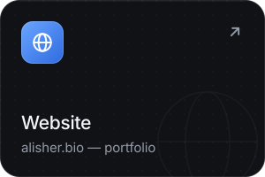
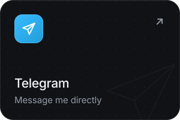
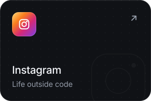
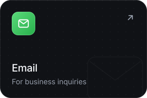
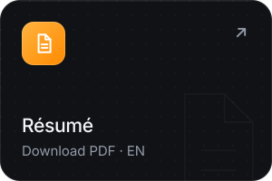
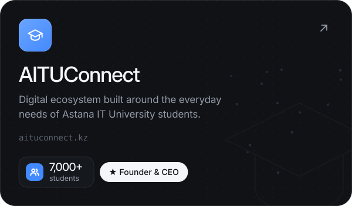
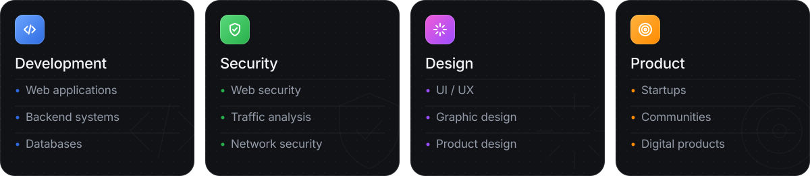
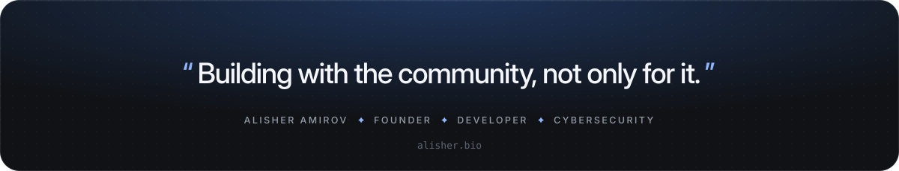

<a href="https://alisher.bio">
  
</a>

<p align="center">
  <a href="https://www.linkedin.com/in/alisheramirovl33t/"></a>
  <a href="https://alisher.bio"></a>
  <a href="https://t.me/mrx_fsociety"></a>
  <a href="https://instagram.com/alisher_l33t"></a>
  <a href="mailto:alisher.amirov032@gmail.com"></a>
  <a href="https://alisher.bio/Alisher-Amirov-CV.pdf"></a>
</p>

## 01 — About

I build products at the intersection of **technology, security and community**.
Right now I'm growing the **AITUConnect** ecosystem for university students and researching
**encrypted traffic analysis** with Sandagrip.

```ts
const alisher = {
  role:       ["Founder", "Developer", "Cybersecurity student"],
  building:   ["AITUConnect", "Sandagrip"],
  studying:   "Information Systems Security @ Astana IT University",
  location:   "Astana, Kazakhstan",
  experience: "5+ years building digital products",
  motto:      "Build things that solve real problems.",
};
```

## 02 — Projects

<p align="center">
  <a href="https://aituconnect.kz"></a>
  <a href="https://sandagrip.com"></a>
</p>

## 03 — Stack

<p align="center">
  <br><br>
  <br><br>
  
</p>

## 04 — What I do



## 05 — Journey



## 06 — GitHub

<p align="center">
  
  
</p>
<p align="center">
  
</p>

<br>

<a href="https://alisher.bio">
  
</a>
